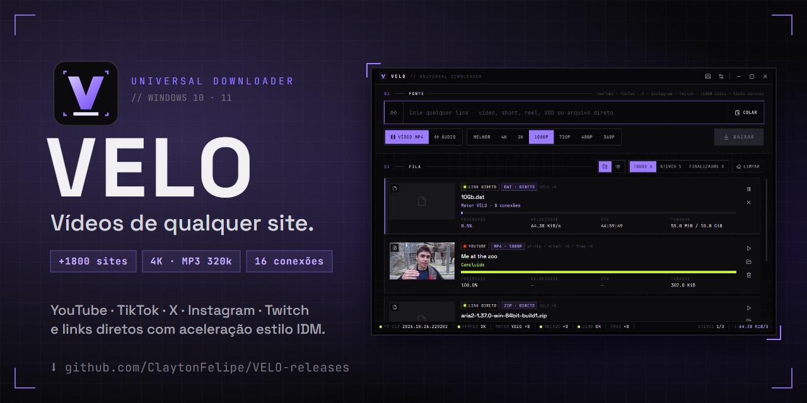
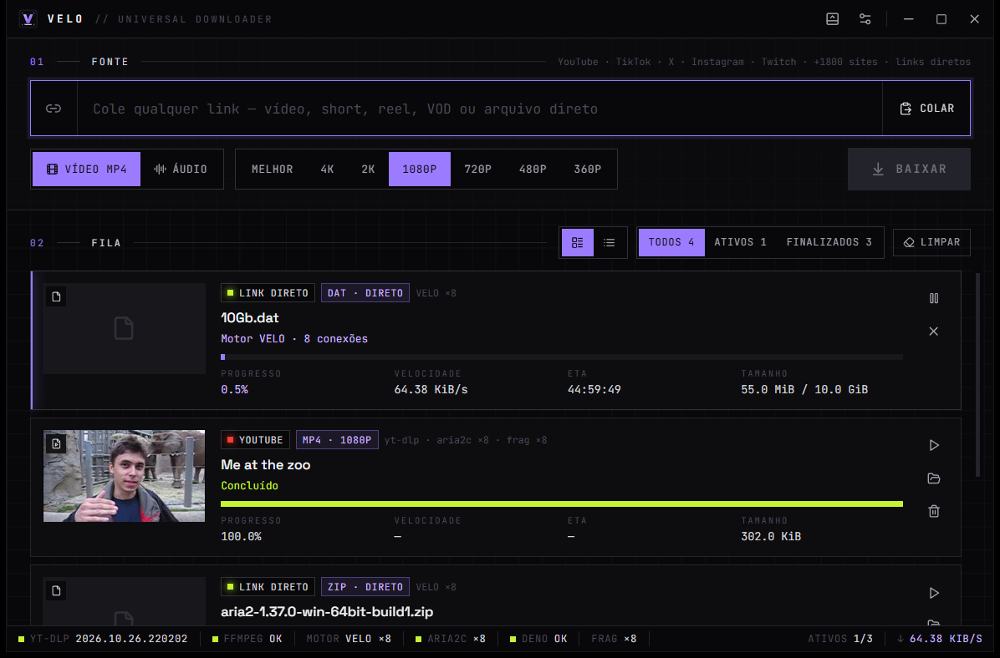
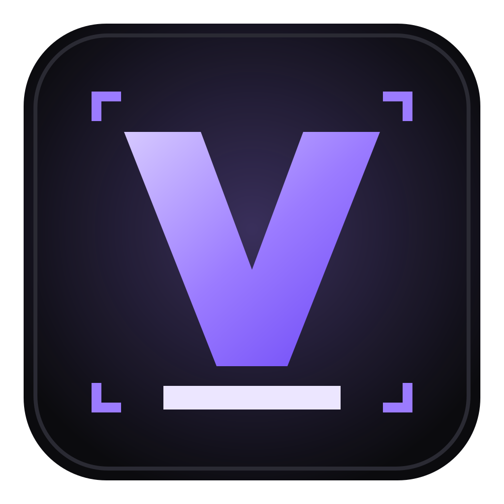

# VELO

**Downloader universal para Windows — vídeos de +1800 sites e qualquer link direto, com aceleração multi-conexão estilo IDM.**

### [⬇ Baixar a versão mais recente](https://github.com/ClaytonFelipe/VELO-releases/releases/latest)

---

## ✦ O que o VELO faz

- **YouTube, TikTok, X, Instagram, Twitch e +1800 sites** — escolha a qualidade (8K, 4K, 2K, 1080p, 720p…) ou baixe só o **áudio em MP3/M4A** (320, 256, 192 ou 128 kbps), com capa e metadados.
- **Links diretos muito mais rápidos** — arquivos (zip, exe, iso, mp4…) baixados com até 16 conexões simultâneas, como no IDM.
- **Pausar e retomar** — mesmo depois de fechar o app ou desligar o PC.
- **Extensão para Chrome, Brave e Edge** — captura downloads do navegador e coloca um botão **"Baixar com VELO"** sobre os vídeos.
- **Modo Toolbar** — um popup na bandeja (`Alt+Shift+D`): cole o link, escolha o formato, pronto.
- **Atualiza sozinho** — quando sai uma versão nova, o VELO avisa e se atualiza com um clique.

## ⬇ Instalação

1. Na [versão mais recente](https://github.com/ClaytonFelipe/VELO-releases/releases/latest), baixe **`VELO_x.y.z_x64-setup.exe`** e execute.
2. O Windows deve mostrar *"O Windows protegeu o computador"* — o instalador ainda não tem assinatura da Microsoft. Clique em **Mais informações → Executar assim mesmo**. A instalação não pede administrador.
3. Abra o VELO. **Na primeira vez** ele baixa os motores de download (~400 MB) mostrando o progresso — depois disso abre direto.

### 🧩 Extensão do navegador (opcional)

1. Baixe **`VELO-extension-vx.y.z.zip`** na mesma página e extraia numa pasta que você não vá apagar.
2. Abra o VELO pelo menos uma vez (ele conecta a extensão ao app).
3. No navegador, abra `chrome://extensions` (no Brave: `brave://extensions`, no Edge: `edge://extensions`).
4. Ative o **Modo do desenvolvedor** → **Carregar sem compactação** → selecione a pasta extraída.
5. Clique no ícone do VELO na barra do navegador: deve aparecer **"Conectado ao VELO"**.

> Ao atualizar a extensão para uma versão nova, substitua a pasta pelo conteúdo do `.zip` novo e clique em **↻ Recarregar** em `chrome://extensions`.

## 🔄 Atualizações

O VELO confere esta página ao abrir e a cada 6 horas. Quando há versão nova, aparece **"Nova versão disponível — Atualizar agora"** no topo da janela; os downloads em andamento são pausados e continuam depois da atualização. Também dá para verificar manualmente em **Configurações → Verificar atualização**.

Cada atualização é **assinada digitalmente** — o VELO só instala pacotes publicados aqui pelo autor.

## 📦 Arquivos de cada versão

| Arquivo | Para quê |
|---|---|
| **`VELO_x.y.z_x64-setup.exe`** | Instalador do Windows — **use este** |
| `VELO_x.y.z_x64_pt-BR.msi` | Instalador MSI (implantação por TI) |
| `VELO-extension-vx.y.z.zip` | Extensão para Chrome / Brave / Edge |
| `*.sig`, `latest.json` | Usados pela atualização automática — não precisa baixar |

## 🔒 Privacidade

Tudo roda no seu computador. O VELO não tem conta, servidor nem telemetria. Os cookies que a extensão envia (para vídeos que exigem login) são usados só naquele download e não ficam salvos.

## ❓ Problemas comuns

| Problema | Solução |
|---|---|
| Vídeo privado ou "Sign in to confirm" | Use a extensão (envia os cookies do site) ou ative **Cookies do navegador** nas configurações — Firefox é o mais confiável. |
| "HTTP 429" | O site limitou as requisições. Reduza conexões/fragmentos nas configurações ou aguarde. |
| Extensão mostra "VELO não encontrado" | Abra o VELO uma vez — ele conecta a extensão ao iniciar. |
| Algo parou de funcionar no YouTube | **Configurações → Forçar atualização do motor**. |

---

Este repositório contém apenas as versões publicadas do VELO. Motores: <a href="https://github.com/yt-dlp/yt-dlp">yt-dlp</a>, <a href="https://ffmpeg.org">FFmpeg</a>, <a href="https://aria2.github.io">aria2</a> e <a href="https://deno.com">Deno</a> · feito com <a href="https://tauri.app">Tauri</a>

